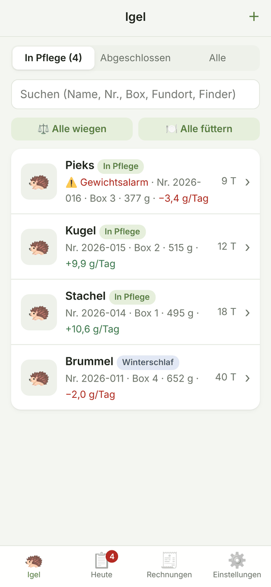
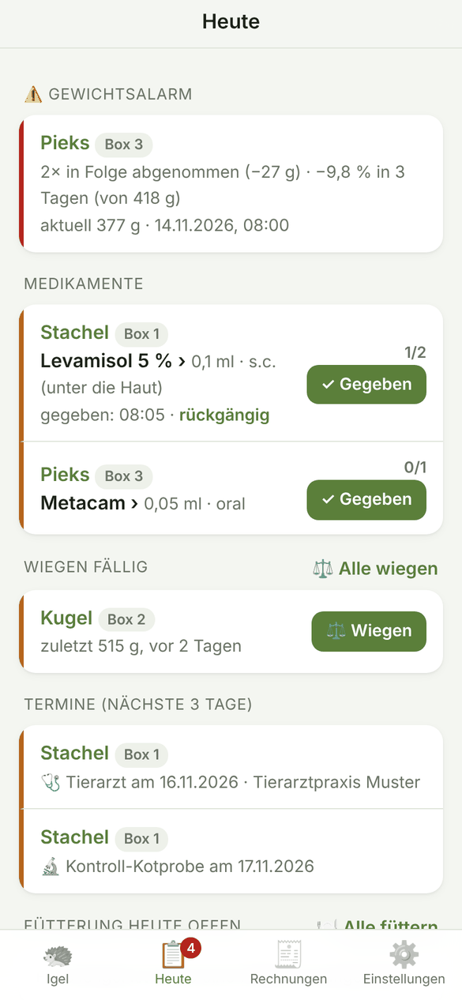
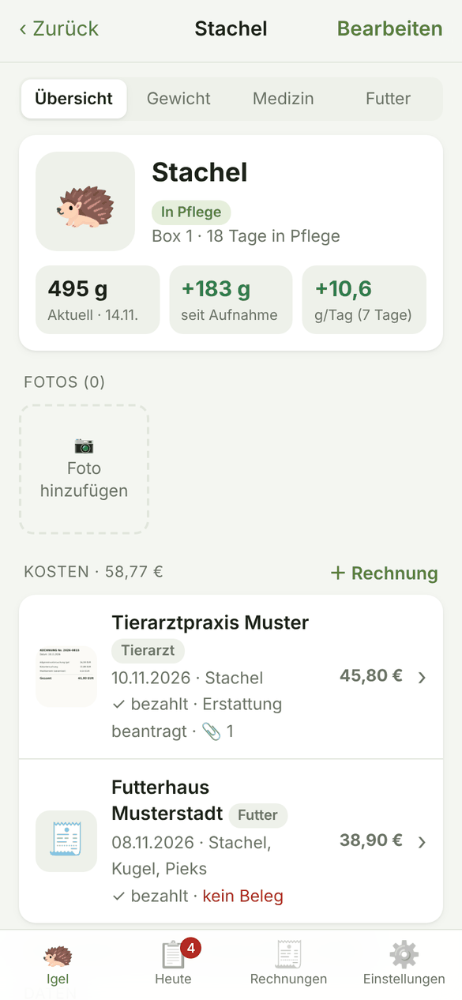
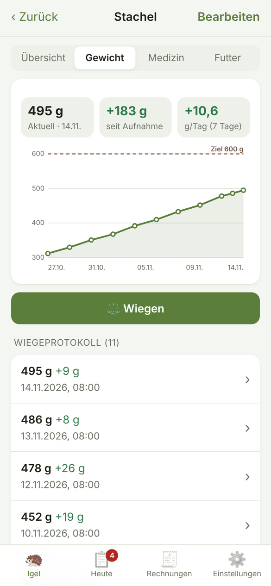
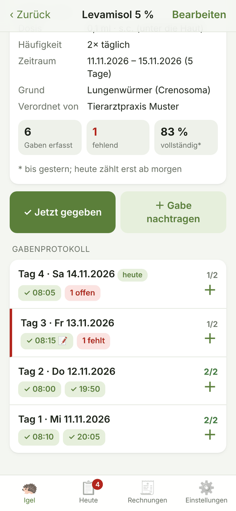
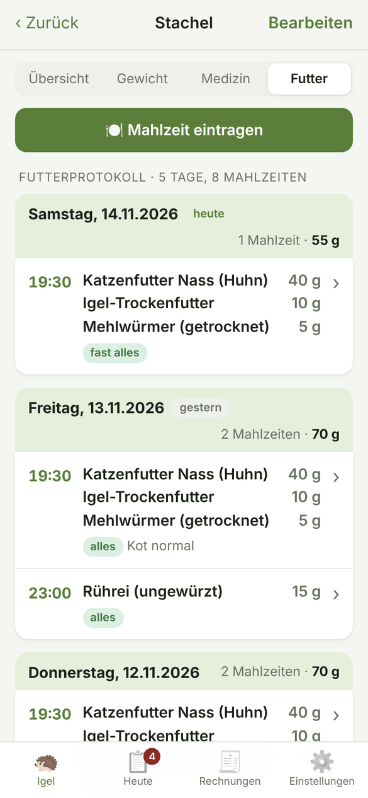
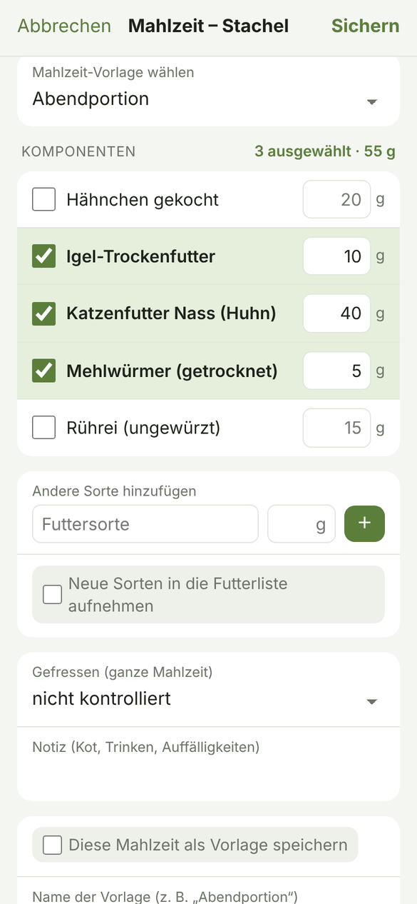
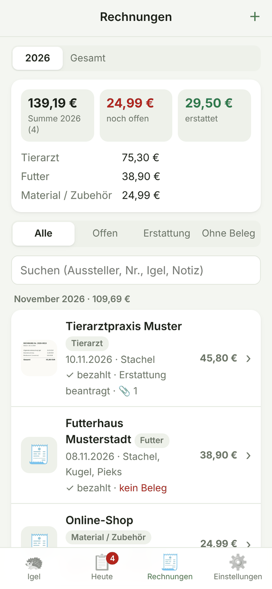
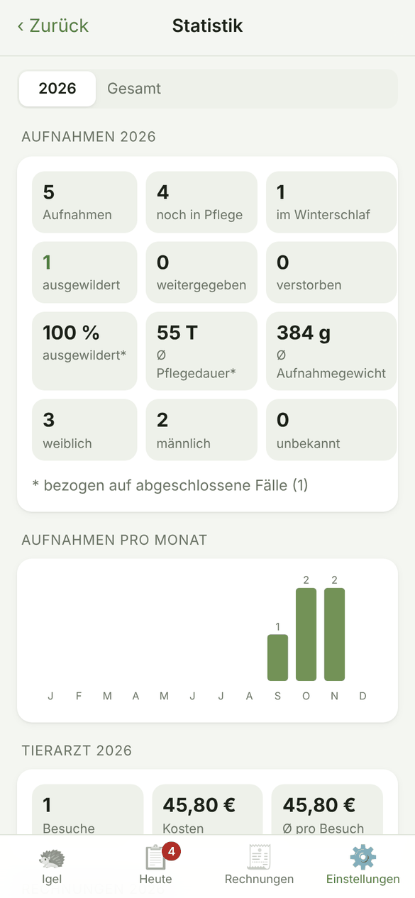

# 🦔 Igelpflege

**Lokale iPhone-App für die Verwaltung von Igeln in einer Pflegestelle. Sie ist kostenlos, läuft offline und braucht kein Konto.**

👉 **App öffnen:** https://wagner-heist.github.io/Igelpflege/

Alle Daten (Igel, Gewichte, Fotos, Medikation, Fütterungen, Rechnungen …) liegen **ausschließlich auf dem iPhone**. Die App schickt keine Daten an einen Server, hat kein Tracking und lädt keine Bibliotheken von fremden Servern. In diesem Repository liegt nur der Programmcode.

Aktuelle Version: **1.8.0**

---

## Screenshots

*Alle Namen, Daten und Belege in den Screenshots sind frei erfunden.*

<table>
  <tr>
    <td align="center" width="33%"><br><b>Igel-Liste</b><br><sub>Status, Box, Gewicht, Trend und Gewichtsalarm</sub></td>
    <td align="center" width="33%"><br><b>Heute</b><br><sub>Alles, was fällig ist, auf einen Blick</sub></td>
    <td align="center" width="33%"><br><b>Igel-Übersicht</b><br><sub>Kennzahlen, Fotos, Kosten, Stammdaten</sub></td>
  </tr>
  <tr>
    <td align="center"><br><b>Gewicht</b><br><sub>Verlauf mit Zielgewicht und Wiegeprotokoll</sub></td>
    <td align="center"><br><b>Gabenprotokoll</b><br><sub>Jeder Behandlungstag, fehlende Gaben rot</sub></td>
    <td align="center"><br><b>Futterprotokoll</b><br><sub>Nach Tagen gegliedert mit Tagessumme</sub></td>
  </tr>
  <tr>
    <td align="center"><br><b>Mahlzeit eintragen</b><br><sub>Mehrere Komponenten, Vorlage mit einem Tipp</sub></td>
    <td align="center"><br><b>Rechnungen</b><br><sub>Mit Beleg, Status und Jahressummen</sub></td>
    <td align="center"><br><b>Jahresstatistik</b><br><sub>Aufnahmen, Ausgänge, Kosten</sub></td>
  </tr>
</table>

---

## Funktionen

### Igel
- Stammdaten: Name, **Pflege-Nr.** (zählt automatisch weiter, z. B. `2026-014` → `2026-015`, doppelte Nummern werden abgelehnt), **Box/Gehege**, Geschlecht, Alter, Status (Aufnahme, In Pflege, Winterschlaf, Ausgewildert, Weitergegeben, Verstorben)
- Fund und Finder: Datum, Ort, Umstände, Name und Kontakt des Finders. Ein bekannter Finder lässt sich aus der Liste auswählen.
- **Winterschlaf:** Beginn und Ende werden beim Statuswechsel automatisch eingetragen. Angezeigt werden Dauer und Gewichtsverlust.
- **Fotos** aus Kamera oder Mediathek, Titelbild wählbar. Fotos werden automatisch verkleinert.
- Liste mit Filter (In Pflege, Abgeschlossen, Alle) und Suche (Name, Nr., Box, Fundort, Finder)

### Gewicht
- Wiegeprotokoll mit **Diagramm** und Zielgewicht-Linie
- Zunahme seit Aufnahme und Ø g/Tag über 7 Tage
- **Gewichtsalarm:** wenn ein Igel 2× in Folge abnimmt oder mehr als X % in N Tagen verliert. Beides ist einstellbar, Igel im Winterschlaf sind ausgenommen.
- **Alle wiegen:** alle Igel nacheinander, sortiert nach Box. Die Taste „Weiter“ springt zum nächsten Igel.
- **Wiegestation (Zusatzfunktion, Einstellungen → Zusatzfunktionen):** für eine umgebaute Waage, die sich als Bluetooth-Tastatur mit dem iPhone koppelt. Igel antippen, auf die Waage setzen: Das stabile Gewicht wird eingetragen, sofort gespeichert, und der nächste Igel ist dran. Die Werte stehen in einer Tabelle und lassen sich ändern. Standardmäßig ausgeschaltet.

### Medizin
- **Medikation** mit Dosis, Verabreichung, Gaben pro Tag und Dauer
- **Gabenprotokoll** pro Behandlungstag. Fehlende Gaben werden rot markiert. Gaben lassen sich nachtragen und mit einer Notiz versehen.
- Gabenverlauf aller Medikamente pro Igel
- **Kotproben** mit Befund aus der eigenen Parasitenliste, Befallsgrad und Kontrolltermin
- **Tierarztbesuche** mit Diagnose, Behandlung, Kosten und nächstem Termin

### Futter
- **Mahlzeiten aus mehreren Komponenten**, jede mit eigener Menge in g. „Gefressen“ wird pro Mahlzeit eingetragen.
- Futterprotokoll **nach Tagen gegliedert** mit Tagessumme
- **Mahlzeit-Vorlagen** (z. B. „Abendportion“): alle Komponenten mit einem Tipp übernehmen
- **Alle füttern:** dieselbe Mahlzeit für mehrere Igel auf einmal eintragen

### Heute
Übersicht beim Öffnen: Gewichtsalarm, fällige Medikamente zum Abhaken, fälliges Wiegen, Tierarzt- und Kontrolltermine der nächsten 3 Tage, noch offene Fütterungen und die Backup-Erinnerung.

### Rechnungen
- Rechnungen mit **Beleg als Foto oder PDF**
- Kategorie, Aussteller, Betrag, Rechnungs-Nr., bezahlt oder offen, Erstattung (beantragt oder erstattet)
- Zuordnung zu einem oder mehreren Igeln (dann anteilig) oder als allgemeine Kosten
- Jahresübersicht mit Summen nach Kategorie, Filter und CSV-Export
- Ein Tierarztbesuch mit Kosten legt die Rechnung automatisch mit an.

### Listen (Einstellungen → Listen)
- 💊 **Medikamentenliste:** Vorlagen mit Dosis, Verabreichung und Dauer
- 🍽️ **Futterliste:** Futtersorten mit Standardmenge
- 🥣 **Mahlzeit-Vorlagen**
- 🔬 **Parasitenliste:** Auswahl für Kotproben, frei erweiterbar
- 👤 **Finderliste:** entsteht automatisch aus den Igel-Daten. Kontakte lassen sich direkt anrufen oder anschreiben.

### Auswertung
- **PDF-Pflegeprotokoll** pro Igel mit Foto, Stammdaten, Gewichtskurve, Medikation, Gabenprotokoll, Kotproben, Tierarzt, Kosten und Futterprotokoll
- **Jahresstatistik:** Aufnahmen, Ausgänge, Quote, Ø Pflegedauer, Aufnahmen pro Monat, Tierarzt- und Rechnungskosten
- **CSV-Exporte** für Excel und Numbers: Igel, Finder, Rechnungen

---

## Auf dem iPhone installieren
1. https://wagner-heist.github.io/Igelpflege/ in **Safari** öffnen (nicht in Chrome).
2. **Teilen** → **„Zum Home-Bildschirm“** → **Hinzufügen**.
3. Die App ab jetzt **nur über das Homescreen-Icon** starten. Die Daten gehören zur Homescreen-App, nicht zum Safari-Tab.

Nach dem ersten Start läuft die App auch ohne Internet.

---

## ⚠️ Datensicherung

Die Daten liegen nur auf dem iPhone. **Regelmäßig sichern:**
**Einstellungen → Backup erstellen → „In Dateien sichern“ → iCloud Drive**

Das Backup ist eine JSON-Datei mit allem, auch Fotos, Belegen und Listen. Beim Einspielen hast du zwei Möglichkeiten:
- **Zusammenführen:** Bei Einträgen, die es auf beiden Seiten gibt, gewinnt die neuere Änderung.
- **Alles ersetzen**

**In diesen Fällen gehen Daten verloren, wenn kein Backup da ist:**
- Die App wird vom Home-Bildschirm gelöscht.
- In Safari wird „Verlauf und Websitedaten löschen“ ausgeführt.
- Das iPhone geht verloren oder wird ersetzt.
- **Das Repository oder der GitHub-Benutzername wird umbenannt.** Die Daten hängen an der genauen Adresse der App.

Unter Einstellungen → Speicher sollte „Dauerhaft: **ja**“ stehen.

---

## Updates einspielen
1. Die geänderten Dateien in dieses Repository hochladen: **Add file → Upload files → Commit changes**.
2. Bei jeder Änderung in `sw.js` die Konstante `CACHE` hochzählen (z. B. `igelpflege-v10` → `igelpflege-v11`) und in `app.js` die Konstante `VERSION` anpassen.
3. 1–2 Minuten warten, bis GitHub Pages neu gebaut hat.
4. Auf dem iPhone die App öffnen, **ganz schließen** (hochwischen und wegschieben) und neu öffnen. Bei Bedarf wiederholen.
5. Kontrolle: Unter **Einstellungen** steht ganz unten die neue Versionsnummer.

Die Daten bleiben bei Updates erhalten.

---

## Versionen
| Version | Neu |
|---|---|
| 1.8.0 | Zusatzfunktion Wiegestation (Bluetooth-Waage), ein- und ausschaltbar |
| 1.7.0 | Eigene, bearbeitbare Parasitenliste. Kotprobe mit „Anderer Parasit“. |
| 1.6.0 | Mahlzeiten aus mehreren Komponenten, Futterprotokoll nach Tagen mit Tagessumme, Mahlzeit-Vorlagen |
| 1.5.0 | Bereich Rechnungen mit Belegen (Foto/PDF), Kosten pro Igel, Rechnung aus Tierarztbesuch |
| 1.4.0 | Gabenprotokoll pro Medikation, Gaben nachtragen, Gabenverlauf, fehlende Gaben im PDF |
| 1.3.0 | Finderliste |
| 1.2.0 | Bearbeitbare Medikamenten- und Futterliste |
| 1.1.0 | Gewichtsalarm, Alle wiegen/füttern, Box/Gehege, Winterschlaf-Daten, Jahresstatistik + CSV, Backup zusammenführen |
| 1.0.2 | Pflege-Nr. zählt automatisch weiter |
| 1.0.1 | Formulare bleiben auf dem iPhone über der Tastatur sichtbar |
| 1.0.0 | Erste Version |

---

## Dateien
| Datei | Zweck |
|---|---|
| `index.html` | Grundgerüst mit Tableiste (Igel, Heute, Rechnungen, Einstellungen) |
| `app.js` | gesamte App-Logik (IndexedDB, Ansichten, Formulare, PDF, Backup) |
| `styles.css` | Gestaltung inkl. Dark Mode |
| `sw.js` | Service Worker für den Offline-Betrieb |
| `manifest.webmanifest` | App-Name und Icons |
| `icons/` | App-Icons |
| `vendor/` | [jsPDF](https://github.com/parallax/jsPDF) 4.2.1 und [jsPDF-AutoTable](https://github.com/simonbengtsson/jsPDF-AutoTable) 5.0.8 (beide MIT-Lizenz), lokal eingebunden |

### Lokal testen
```bash
python3 -m http.server 8000
```
Dann http://localhost:8000 im Browser öffnen.
